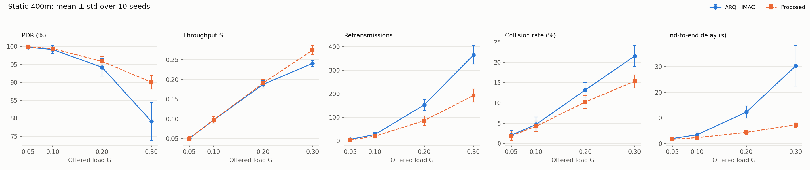
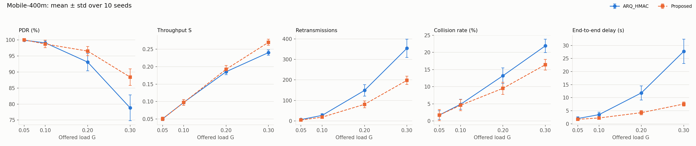
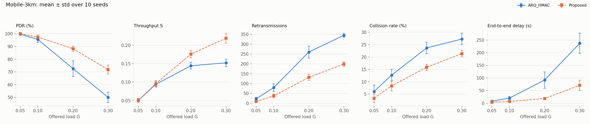
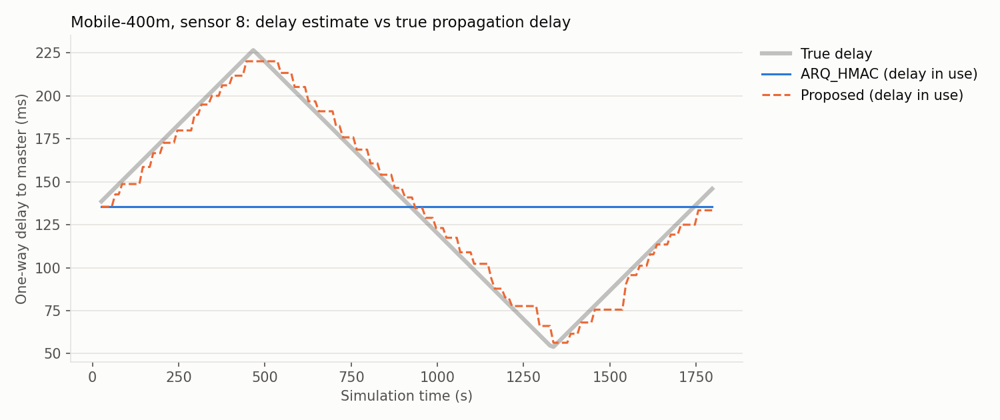

# Adaptive ARQ_HMAC: Adaptive Retransmission Scheduling for Underwater Acoustic Sensor Networks

This repository implements and compares two MAC protocols for underwater acoustic sensor networks (UASNs)
in the [UnetStack](https://unetstack.net) 7 simulator:

- **ARQ_HMAC**, the hybrid CSMA/TDMA protocol of Dao & Tran, *IEEE Access*, 2025 (the baseline), and
- **Adaptive ARQ_HMAC** (called *Proposed* below), our upgrade, which makes the protocol adapt to a
  changing channel instead of relying on values measured once at network start-up.

Both protocols run on **identical traffic and node motion**, and are compared on packet delivery ratio,
throughput, number of retransmissions, collision rate and end-to-end delay.

**Headline result** (240 simulations, mean over all loads and 10 seeds; all differences significant, p < 0.05):

| | Static network, 400 m | Moving AUVs, 400 m | Moving AUVs, 3 km |
|---|---|---|---|
| End-to-end delay | **−67 %** | **−65 %** | **−72 %** |
| Retransmissions | **−45 %** | **−44 %** | **−47 %** |
| Collision rate | **−24 %** | **−23 %** | **−30 %** |
| Throughput | **+6.5 %** | **+6.3 %** | **+23 %** |
| Packet delivery ratio | **+3.5 %** | **+3.4 %** | **+12 %** |

---

## Contents

1. [Repository layout](#1-repository-layout)
2. [Requirements and how to run](#2-requirements-and-how-to-run)
3. [Background: the problem](#3-background-the-problem)
4. [Baseline: ARQ_HMAC (2025)](#4-baseline-arq_hmac-2025)
5. [Proposed: Adaptive ARQ_HMAC](#5-proposed-adaptive-arq_hmac)
6. [Simulation setup](#6-simulation-setup)
7. [Metrics and evaluation method](#7-metrics-and-evaluation-method)
8. [Results](#8-results)
9. [Why it works](#9-why-it-works)
10. [Limitations](#10-limitations)
11. [Design decisions that were tested and rejected](#11-design-decisions-that-were-tested-and-rejected)
12. [Deviations from the paper](#12-deviations-from-the-paper)
13. [References](#13-references)

---

## 1. Repository layout

```
.
├── README.md                    this file
├── run_all.sh                   one command: all simulations, then statistics and figures
├── run_comparison.groovy        the experiment (UnetStack simulation script)
├── plot_results.py              paired significance tests and figures
├── arqhmac/
│   ├── ArqHmacAgent.groovy      the MAC protocol: proposed = false -> ARQ_HMAC, true -> Proposed
│   └── Scenario.groovy          topology, AUV motion, shared traffic traces, random seeds
├── results/                     output of the last full run (CSV data, tables, figures)
│   ├── statistics.txt           final comparison with p-values
│   ├── fig_Static-400m.png      metrics vs offered load, one figure per channel condition
│   ├── fig_Mobile-400m.png
│   ├── fig_Mobile-3km.png
│   ├── fig_estimate_tracking.png  delay estimate vs true propagation delay over time
│   ├── runs_*.csv               one row per simulation run
│   └── estimate_trace.csv       data behind fig_estimate_tracking.png
├── docs/
│   ├── ARQ_HMAC_Dao_Tran_2025.pdf   the baseline paper
│   ├── Project_Proposal.pdf
│   └── Progress_Report.pdf
└── unet-7.0.0/                  UnetStack distribution (not in git, see Requirements)
```

## 2. Requirements and how to run

**Requirements**

- Linux or macOS with Java 8 or newer.
- UnetStack 7.0.0 (community edition), unpacked into `unet-7.0.0/` in this folder, so that
  `unet-7.0.0/bin/unet` exists. Download it from <https://unetstack.net>.
- Python 3 with `matplotlib` and `scipy` (`pip install matplotlib scipy`).
- About 6 GB of free memory to run 4 simulation processes in parallel.

**Run everything** (240 simulations, about 20 minutes on a 4-core machine):

```bash
cd Actual_CN_proj
./run_all.sh                 # or JOBS=2 ./run_all.sh on a machine with little memory
```

This writes all files in `results/` and then prints the statistics. Progress is visible with
`tail -f results/log_*.txt`.

**Run a part only**, e.g. one channel condition and five seeds:

```bash
ONLY_CONDITION=Mobile-400m ONLY_SEEDS=1-5 unet-7.0.0/bin/unet run_comparison.groovy
python3 plot_results.py
```

All commands must be started **from this folder**, because UnetStack finds the `arqhmac` package relative
to the current directory. Loads, seeds, run length and channel conditions are set at the top of
`run_comparison.groovy`.

**Reproducibility.** The simulator is deterministic, and every source of randomness (traffic and backoff) is
seeded from the run's `(seed, load, node)`. Re-running any configuration gives exactly the same numbers,
independent of how runs are split over processes.

## 3. Background: the problem

Underwater networks communicate with sound, which travels at only about 1500 m/s. Propagation delays are
therefore long (0.27 s over 400 m, 2 s over 3 km) and comparable to the time it takes to send a packet. A MAC
protocol has to know these delays to time acknowledgements and retransmissions correctly.

ARQ_HMAC measures each sensor's delay to the master node **once**, at network start-up, and uses that value
for the whole operation. It protects itself against timing errors with a large, fixed guard time. Underwater,
the delay does not stay constant: sound speed varies with temperature and salinity, and nodes move (AUVs,
drifting sensors). Our project proposal and progress report set out to replace the one-time estimate with an
adaptive one, and to evaluate both protocols under varying load and changing channel conditions.

## 4. Baseline: ARQ_HMAC (2025)

Implemented in `ArqHmacAgent.groovy` with `proposed = false`, following Sec. III of the paper:

| Phase | What happens | Paper |
|---|---|---|
| INIT | Each sensor sends one probe in its own interval; the master ACKs it. The sensor computes its one-way delay `tDi = (ti - (td + tACK) - ti0) / 2`. | Eq. 1, 2 |
| CSMA | A sensor with a packet senses the channel, transmits when it is free and waits `ttime_out = 2 tDi + tguard`, with `tguard = 2 td + tACK`, for an ACK. | Eq. 3, 4 |
| TDMA | On a collision the master broadcasts a NACK. Every sensor that hears it, or whose ACK timed out, retransmits in its own TDMA slot of width `tslot = tmax + tguard`, without ACK. Then all return to CSMA. | Eq. 5-10 |

Here `td` = 1 s (data frame), `tACK` = 0.1 s (control frame) and `tmax` = range / 1500 m/s.

## 5. Proposed: Adaptive ARQ_HMAC

Implemented in the same agent with `proposed = true`. It keeps the three phases of ARQ_HMAC and adds five
adaptive mechanisms. Mechanism 5.1 is the scheme of our progress report; 5.2 to 5.5 extend it.

### 5.1 Adaptive delay estimate (progress report, Sec. 3)

Every new delay observation `tObs` updates an exponentially weighted moving average (Report Eq. 1):

```
tHat = alpha * tObs + (1 - alpha) * tHat
```

The value used by the protocol, `tsched`, is only replaced when the estimate has drifted by more than a
threshold (Report Eq. 3, Algorithm 1): `if |tHat - tsched| > theta: tsched = tHat`, after which the ACK
timeout and the TDMA schedule are recomputed. Parameters: `alpha = 0.7` (observations arrive only every few
seconds to minutes while an AUV keeps moving, so the newest one is weighted heavily) and `theta = 5 ms`.

### 5.2 Timestamped delay observations

In the progress report a sensor measures its delay from the round trip of its own data and ACK (Report
Eq. 2), which happens roughly once per 100 s per sensor; the estimate then lags behind a moving node. Instead,
the master writes its transmit time into every ACK and NACK. Nodes share a synchronised clock after the INIT
phase (the paper resets t = 0 for all nodes there), so **every master frame a sensor overhears**, including
ACKs addressed to other sensors, is a one-way delay observation:

```
tObs = t_receive_end - t_transmit_start - tACK
```

The master tracks when its modem becomes free, so the timestamp is exact even when frames queue. ACKs are
broadcast with the destination address in the payload, so all sensors overhear them (both protocols do this;
it does not change ARQ_HMAC's behaviour). In the simulations each sensor gets about 130 observations per
30-minute run at G = 0.1, instead of one per own ACK.

### 5.3 Adaptive guard time

The paper's guard `2 td + tACK` contains about 1 s of spare time to absorb timing errors. With an accurate,
continuously measured delay most of that is not needed. The guard is sized from the measured variation of the
delay, the way TCP sizes its retransmission timeout (Jacobson's algorithm, RFC 6298, with the RFC's constants
`beta = 1/4`, `K = 4`):

```
dev    = (1 - beta) * dev + beta * |tObs - tHat|
tguard = td + tACK + max(tACK, 2 K dev)
```

`td + tACK` is the time the data and ACK frames themselves take; the rest covers uncertainty. `dev` starts at
`td / (2K)`, which gives exactly the paper's guard, and only shrinks as measurements show that the delay is
predictable. Each sensor uses its own guard for its ACK timeout. TDMA slots must be identical for all nodes,
so sensors report `dev` in their data frames (1 byte); the master sizes the slot for the least predictable
sensor and announces the slot width in every NACK.

### 5.4 Arrival-aligned TDMA slots

In ARQ_HMAC every sensor transmits at the start of its slot, so its frame reaches the master up to `tmax`
later; that is why a slot is `tmax + tguard` wide (Eq. 6). In the Proposed protocol each sensor starts its
transmission `tsched` (its delay estimate) before its slot, so frames **arrive** at the master back to back
and a slot is only `tguard` wide. This saves `tmax` per slot: 0.27 s at 400 m, 2 s at 3 km. It is only safe
because the delay estimate is accurate (5.1, 5.2).

### 5.5 Adaptive backoff

When a TDMA round ends, every sensor with a waiting packet returns to CSMA at the same moment, and sensors
that waited for a busy channel all transmit as soon as it frees up; both cause collisions. In the Proposed
protocol a sensor first waits a random time in `[0, cw * 2 tmax]`. `2 tmax` is the longest propagation time
between two sensors, so the first sensor to transmit is heard by the others before their backoff ends. The
window `cw` adapts by binary exponential backoff as in IEEE 802.11: doubled after every NACK or timeout (up
to 16) and reset to 1 after a success.

### 5.6 Parameters

| Parameter | Value | Source |
|---|---|---|
| `alpha` | 0.7 | sparse observations, see 5.1 |
| `theta` | 5 ms | progress report |
| `beta`, `K` | 1/4, 4 | RFC 6298 (not tuned) |
| `cw` | 1 ... 16, unit `2 tmax` | IEEE 802.11 binary exponential backoff; longest sensor-to-sensor propagation time |

## 6. Simulation setup

**Channel and modem** (paper Table 2): 1200 bps; data frames of 1200 bits (`td` = 1 s); control frames of 120
bits (`tACK` = 0.1 s); sound speed 1500 m/s. UnetStack's `ProtocolChannelModel`: a frame is lost only through
a collision or because the receiver is itself transmitting.

**Topology** (`Scenario.groovy`; distances scale with the network range R; all nodes at 50 m depth):

- master (gateway) moored at the centre;
- 4 moored sensors at 0.38R to 0.75R;
- 6 AUV sensors patrolling radially between 0.2R and 0.85R, each on its own bearing and phase.

All sensors stay within range of the master. Sensors on opposite sides cannot hear each other (hidden
terminals), as in a real deployment.

**Channel conditions:**

| Condition | Range R | AUV speed | One-way delay change during a run |
|---|---|---|---|
| Static-400m | 400 m | 0 (paper setup) | none |
| Mobile-400m | 400 m | 0.3 m/s | up to 0.17 s |
| Mobile-3km | 3000 m | 2 m/s | up to 1.3 s |

**Traffic:** Poisson arrivals at each sensor; network offered load G = 0.05, 0.1, 0.2 and 0.3 packets per
data-frame time (G = 0.1 means one new packet every 10 s in the whole network). Each run lasts 1800 s.

## 7. Metrics and evaluation method

| Metric | Definition |
|---|---|
| Packet delivery ratio (PDR) | unique packets received by the master / packets generated |
| Throughput S | delivered packets × `td` / operating time (normalised, as in the paper) |
| Retransmissions | packets that had to be resent in a TDMA slot after a failed CSMA attempt |
| Collision rate | collisions detected at the master / frames sent by sensors |
| End-to-end delay | time from packet generation to its first reception at the master |
| Delay estimate error | \|delay value in use − true delay from the node's position\|, sampled every 10 s (diagnostic) |

**Method:**

- **Identical conditions.** For every (condition, load, seed) one traffic trace is generated and replayed
  through both protocols, with the same topology and motion. The script checks that both protocols generated
  exactly the same packets.
- **Repetition.** 3 conditions × 4 loads × 10 seeds × 2 protocols = 240 runs.
- **Statistics.** Because the two protocols see the same traffic, runs are compared in pairs with the
  two-sided Wilcoxon signed-rank test (40 pairs per condition). A difference is called significant only if
  p < 0.05. `b/e/w` in `results/statistics.txt` counts the pairs in which Proposed was better, equal or worse.
- **No tuning on the test data.** During development, every design decision was made on separate tuning seeds
  (101-105), never on the evaluation seeds 1-10 reported here (see Section 11).

## 8. Results

### 8.1 Summary (mean over 4 loads × 10 seeds; from `results/statistics.txt`)

| Condition | Metric | ARQ_HMAC | Proposed | Change | Better / equal / worse | p |
|---|---|---|---|---|---|---|
| Static-400m | PDR | 93.08 % | 96.30 % | +3.5 % | 22 / 13 / 5 | < 0.001 |
| | Throughput S | 0.144 | 0.153 | +6.5 % | 22 / 13 / 5 | < 0.001 |
| | Retransmissions | 138.1 | 75.9 | −45.1 % | 36 / 4 / 0 | < 0.001 |
| | Collision rate | 10.37 % | 7.92 % | −23.6 % | 27 / 3 / 10 | < 0.001 |
| | End-to-end delay | 12.01 s | 3.96 s | −67.0 % | 39 / 0 / 1 | < 0.001 |
| Mobile-400m | PDR | 92.72 % | 95.92 % | +3.4 % | 22 / 10 / 8 | < 0.001 |
| | Throughput S | 0.143 | 0.152 | +6.3 % | 22 / 10 / 8 | < 0.001 |
| | Retransmissions | 134.2 | 75.4 | −43.8 % | 36 / 3 / 1 | < 0.001 |
| | Collision rate | 10.42 % | 8.06 % | −22.7 % | 27 / 2 / 11 | < 0.001 |
| | End-to-end delay | 11.26 s | 3.93 s | −65.1 % | 39 / 0 / 1 | < 0.001 |
| Mobile-3km | PDR | 79.46 % | 89.34 % | +12.4 % | 30 / 8 / 2 | < 0.001 |
| | Throughput S | 0.110 | 0.135 | +22.7 % | 30 / 8 / 2 | < 0.001 |
| | Retransmissions | 176.9 | 94.3 | −46.7 % | 40 / 0 / 0 | < 0.001 |
| | Collision rate | 17.42 % | 12.22 % | −29.9 % | 39 / 1 / 0 | < 0.001 |
| | End-to-end delay | 89.37 s | 25.11 s | −71.9 % | 40 / 0 / 0 | < 0.001 |

The delay estimate error drops from 36.3 ms to 3.0 ms (Mobile-400m) and from 306 ms to 15 ms (Mobile-3km); in
the static network both protocols are exact (0.2 ms).

### 8.2 Per offered load (ARQ_HMAC → Proposed, mean over 10 seeds)

| Condition | G | PDR (%) | Throughput S | Retransmissions | Collision rate (%) | Delay (s) |
|---|---|---|---|---|---|---|
| Static-400m | 0.05 | 99.8 → 99.9 | 0.050 → 0.050 | 6.7 → 4.2 | 2.0 → 1.9 | 2.0 → 1.7 |
| | 0.10 | 99.2 → 99.4 | 0.098 → 0.098 | 27.0 → 19.9 | 4.7 → 4.2 | 3.5 → 2.4 |
| | 0.20 | 94.2 → 95.9 | 0.188 → 0.191 | 153.3 → 86.2 | 13.2 → 10.2 | 12.3 → 4.4 |
| | 0.30 | 79.1 → 90.0 | 0.241 → 0.275 | 365.5 → 193.2 | 21.5 → 15.3 | 30.3 → 7.4 |
| Mobile-400m | 0.05 | 99.9 → 100.0 | 0.050 → 0.050 | 6.5 → 4.4 | 1.7 → 1.7 | 2.0 → 1.7 |
| | 0.10 | 99.1 → 98.7 | 0.098 → 0.097 | 27.0 → 18.3 | 4.9 → 4.6 | 3.5 → 2.2 |
| | 0.20 | 93.1 → 96.5 | 0.185 → 0.192 | 149.0 → 80.9 | 13.2 → 9.5 | 11.8 → 4.2 |
| | 0.30 | 78.8 → 88.4 | 0.240 → 0.270 | 354.4 → 198.0 | 21.9 → 16.4 | 27.7 → 7.5 |
| Mobile-3km | 0.05 | 99.7 → 100.0 | 0.050 → 0.050 | 23.1 → 9.2 | 6.0 → 3.3 | 8.0 → 4.1 |
| | 0.10 | 95.5 → 97.3 | 0.094 → 0.096 | 79.3 → 37.0 | 12.7 → 8.3 | 20.4 → 7.0 |
| | 0.20 | 72.6 → 88.3 | 0.144 → 0.176 | 260.0 → 131.8 | 23.7 → 15.9 | 91.9 → 18.6 |
| | 0.30 | 50.0 → 71.8 | 0.152 → 0.219 | 345.2 → 199.2 | 27.3 → 21.4 | 237.2 → 70.7 |

### 8.3 Figures

Metrics vs offered load (mean ± standard deviation over 10 seeds):





Delay value used by each protocol vs the true propagation delay of one AUV (Mobile-400m, G = 0.1, seed 1):
ARQ_HMAC keeps its start-up value, while the Proposed protocol follows the AUV.



## 9. Why it works

1. **Accurate delay knowledge** (5.1, 5.2): the delay estimate error falls by 92-95 % when nodes move.
2. **Accurate knowledge makes shorter timing safe** (5.3, 5.4): the guard time shrinks from 2.1 s to about
   1.2-1.4 s, and the TDMA slot from `tmax + 2.1 s` (2.37 s at 400 m, 4.1 s at 3 km) to 1.2-1.6 s. A TDMA round
   for 10 sensors therefore takes 12-16 s instead of 24-41 s, and ACK timeouts are almost a second shorter.
   This is the main source of the delay reduction.
3. **Fewer synchronised transmissions** (5.5): random backoff after a busy channel and after each TDMA round
   removes many collisions, which nearly halves the number of retransmissions and raises PDR and throughput at
   high load.
4. **Long range benefits most**: at 3 km, `tmax` is 2 s, so removing it from every slot and keeping the
   estimate accurate matters most; that is where throughput (+23 %) and PDR (+12 %) gain most.

## 10. Limitations

- **Gains are small at light load.** At G ≤ 0.1 both protocols deliver 95-100 % of the packets and the
  differences in PDR and throughput are within ±2 %; in one case the Proposed protocol is slightly lower
  (Mobile-400m, G = 0.1: 98.7 vs 99.1 %). The large gains appear at G ≥ 0.2, where contention dominates.
- **Lost TDMA retransmissions are not recovered.** As in the paper, TDMA slots have no acknowledgement; a slot
  frame that is lost (e.g. it collides with a sensor still in CSMA) is lost for good, in both protocols.
- **Backoff at long range.** The backoff unit `2 tmax` is 4 s at 3 km, so backoff adds noticeable delay there
  (delay is still 72 % lower than with ARQ_HMAC).
- **Clock synchronisation.** Timestamped observations assume synchronised clocks. They are perfect in the
  simulator; in a real deployment clock drift would bias the observations and require periodic resync.
- **Simulation model.** The protocol channel model ignores bit errors, multipath and variable sound speed; the
  delay changes come from node motion only.

## 11. Design decisions that were tested and rejected

During development, candidate mechanisms were evaluated on separate tuning seeds (101-105) and kept only if
they helped there. The code of rejected designs is not part of this repository.

Note: those tuning runs used an earlier version of the traffic generator in which the sensors' random
generators were created from consecutive seeds, so all sensors generated their first packet at almost the same
time (a known weakness of `java.util.Random`). This was fixed (seeds are scrambled with a hash, see
`Scenario.mix`) before the final evaluation in Section 8; the tuning numbers below are therefore indicative.

- **Adaptive estimate alone (the progress report's scheme without 5.2-5.5).** With the paper's fixed guard, the
  one-time estimate of ARQ_HMAC almost never causes a failure: the guard tolerates about 0.5 s of delay error,
  i.e. 750 m of movement. Improving the estimate alone therefore changed PDR and throughput by about 1 % or
  less. The benefit appears only once the accurate estimate is used to shorten the guard and the slots
  (5.3, 5.4).
- **Confirming TDMA retransmissions with a block ACK.** Because every lost packet is lost in a TDMA slot, we
  tried a bitmap ACK broadcast by the master at the end of each TDMA round, with unconfirmed packets retried.
  It raised PDR to 96-100 % at light load (G ≤ 0.1), but caused congestion collapse at G ≥ 0.2 (PDR as low as
  7-27 %, delays of several minutes): every retry adds contention, which creates more collisions and more TDMA
  rounds. A second version (sensors silent until the block ACK arrives, retries with backoff) still fell to
  51-66 % PDR at G = 0.3. A TDMA confirmation scheme that stays stable under load remains future work.

## 12. Deviations from the paper

- **TDMA slot index.** The paper computes a sensor's slot as `ni = floor(tDi / tslot)` (Eq. 8). Since
  `tDi < tmax < tslot`, this is always 0 and would put every sensor in the same slot. Each sensor uses its own
  slot (its index in the network), which matches `tTDMA = n tslot` (Eq. 9). Both protocols do this.
- **Collision detection.** The master detects a collision when the modem reports a frame it could not decode
  and answers with a NACK, as in the paper.
- **Traffic.** The paper spreads packet generation uniformly over the simulation; we use Poisson arrivals with
  a fixed offered load, which allows a load sweep.

## 13. References

1. V.-P. Dao and T.-H. Tran, "ARQ_HMAC: An Automatic Repeat reQuest Strategy for Hybrid MAC Protocol in
   Underwater Acoustic Sensor Networks," *IEEE Access*, vol. 13, pp. 159196-159206, 2025,
   doi: 10.1109/ACCESS.2025.3607746 (`docs/ARQ_HMAC_Dao_Tran_2025.pdf`).
2. V. Paxson, M. Allman, J. Chu and M. Sargent, "Computing TCP's Retransmission Timer," RFC 6298, 2011.
3. IEEE Std 802.11, Wireless LAN Medium Access Control and Physical Layer Specifications (binary exponential
   backoff).
4. A.-R. Cho, C. Yun, Y.-K. Lim and Y. Choi, "Asymmetric Propagation Delay-Aware TDMA MAC Protocol for Mobile
   Underwater Acoustic Sensor Networks," *Applied Sciences*, vol. 8, no. 6, p. 962, 2018.
5. M. Chitre, R. Bhatnagar and W.-S. Soh, "UnetStack: An agent-based software stack and simulator for
   underwater networks," *Proc. IEEE OCEANS*, 2014.
6. Project proposal and progress report of this project (`docs/`).
